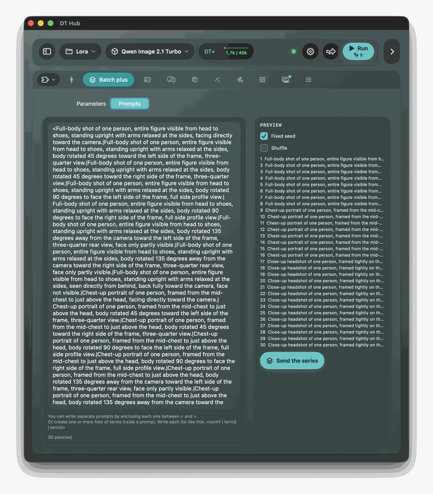
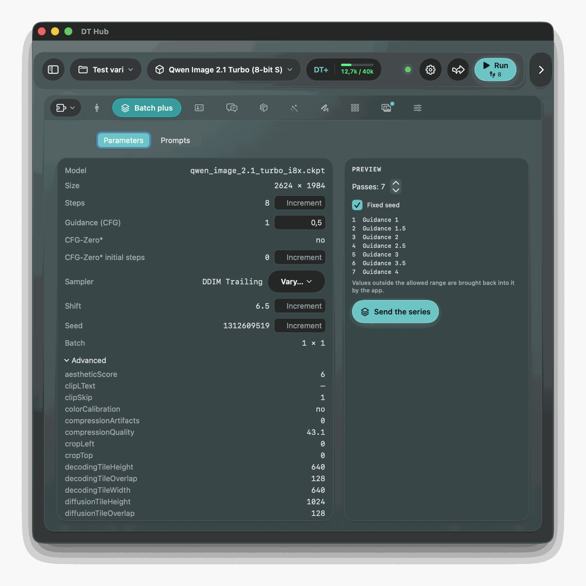
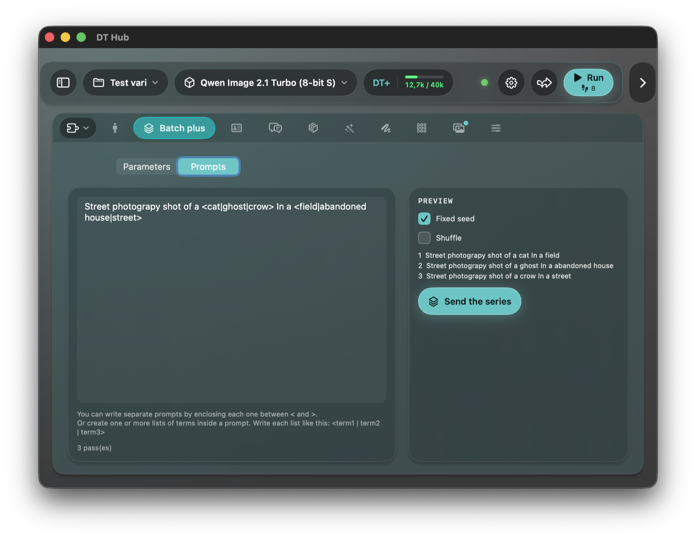
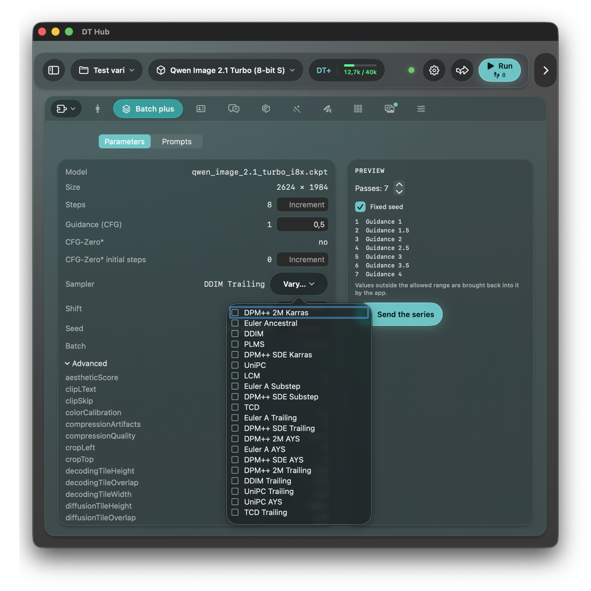

# Batch plus

A plug-in for DT Hub that prepares a **series of consecutive RUNs** and sends it to the app as a pipeline: you press **Run** and get one image per pass. **Works with: all model families.**

  
  
  
  

Two modes, one at a time:

- **Parameters.** The parameters of the Generation tab are shown read-only, each number that can vary with an **Increment** box. The number of passes is 2–50; pass *k* uses *value + (k − 1) × increment*, and several increments vary **together**. Pass 1 uses the current values. Steps 10 (+10) and guidance 3 (+2) over 3 passes give (10, 3), (20, 5), (30, 7).
  Varying parameters: **steps, guidance, shift, CFG-Zero\* initial steps, seed and the weight of each LoRA**. The **sampler** varies too, with a menu of the 20 samplers: tick them in the order you want, at most one per pass (pass 1 uses the first, and so on; later passes keep the tab's sampler). The others (model, size, switches, batch, advanced values, extras) are shown without an increment.
- **Prompts.** One prompt written with **lists of terms**, one pass per term. A term sits between `<` or `|` and `>` or `|`: `<dog|cat|squirrel>` is a list of three terms. The text outside the lists is the same in every pass. Pass *k* takes the *k*-th term of each list, **not every combination**:
  `A photo of a <dog|cat|squirrel> that <runs|jumps|rolls> on a lawn` gives three prompts (dog, runs), (cat, jumps), (squirrel, rolls). Terms on separate lines with nothing between them are one list: `<text1>` newline `<text2>` newline `<text3>` gives three prompts. With lists of different lengths the passes are as many as the longest list, and a shorter one keeps its last term for the extra passes. A `>` outside a list and a `<` inside a term are plain text (no `><`). The **Shuffle** switch uses each list in a random order of its own (the preview shows the order that will be sent; the dice button shuffles again, and every send draws a new order); with a shorter list, it goes on in a fresh random order.

Details:

- The increment accepts a comma or a point and a sign (`-0,5`); empty or `0` means "does not vary". Steps, initial steps and seed need whole numbers. A red border marks a box that is not valid.
- **Fixed seed** (on by default): every pass uses the current seed with the random seed switched off; with an increment on the seed, the seed grows by that amount (never random). It also applies to Prompts mode, so the results are comparable.
- With "Shift: auto" on, Draw Things ignores the shift and its increment box is disabled.
- The **preview** lists the values of each pass, as computed; the app brings values outside the allowed range back into it.
- A pass changes only what it lists: **never a size, never a preset**; the advanced values and the extras are those of the tab. This uses the `fields` and `loras` of a pipeline step (`PluginKit/README.md`) and needs a DT Hub that sends the tab's `parameters` in the context; otherwise the Parameters mode says so and Prompts mode still works.
- The state (mode, increments, passes, fixed seed, prompts) is kept **per project**.

## For AI agents (MCP)

Since **1.2**. With DT Hub's remote control on (Settings › Remote control) and the plug-in **on for the job**, an agent sees these tools, named `plugin__batchplus__<tool>`, for every model family. Needs a DT Hub with MCP plug-in tools that can run a plug-in's pipeline (after 1.3.1; the run of a static list of passes needs the version that follows).

- `get_status` (read): the mode, passes, increments, samplers, switches, the values of the Generation tab the series starts from (with its LoRAs), the preview of every pass (or the prompts the text makes), the number of RUNs, and why the series cannot go (`blocker`).
- `set_batch` (edit, «Modify the tab» or more): defines the series on the tab **without generating** and answers the preview, so the agent can judge it first. Arguments (all optional; what you leave out stays): `mode` (`parameters` or `prompts`), `passes` (2–50), `steps_increment`, `guidance_increment`, `shift_increment`, `cfg_zero_steps_increment`, `seed_increment`, `lora_file` + `lora_increment`, `samplers` (comma-separated sampler numbers, listed by `get_status`), `fixed_seed`, `prompt_text`, `shuffle` and `reset`. `0` clears an increment. Everything is checked before anything changes.
- `start_batch` (generate, «Full control» only): does what `set_batch` does with the same arguments (none: what it defined) and then presses RUN. It returns a `job_id` at once; the agent follows it with `wait_for_job`, stops it with `stop` and reads the pictures with `get_results` / `get_image`.

**Budget and consent.** Starting goes through the same path as the app's `run_pipeline`: one job at a time, **every pass is a RUN and counts as images against the session budget** (the batch count and size of the tab multiply it), and a series over the user's confirmation threshold waits for the user's yes in DT Hub. From 20 passes (where the tab shows its warning) `start_batch` refuses unless the call carries `confirm_long: true`: the agent must ask the user first. A series never changes a size or a preset, as in the tab.

The prompts and the file names in the answers come from the project and from the agent's own earlier calls: DT Hub marks them to the agent as data, not instructions.

Build: `Plugins/BatchPlus/Scripts/build.sh <folder>` → `BatchPlus.dthubplugin`. Tests: `swift test` in this folder. Design: `docs/superpowers/specs/2026-10-09-plugin-batch-plus-design.md`.
