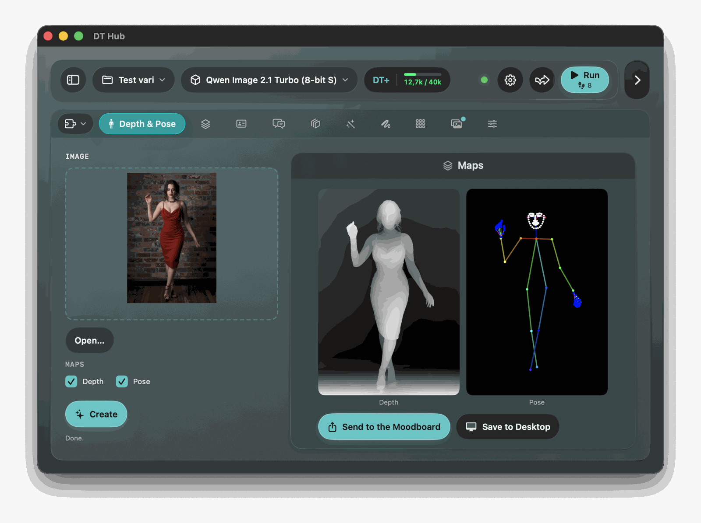

# Depth & Pose

A plug-in for DT Hub that makes a **depth map** and/or a **DWPose-style skeleton** (body, face and hands) from one picture, in a moment, and puts them in the Moodboard (or on your Desktop), so an edit or in-context model can take them as a reference. **Works with: edit and in-context models, whatever their family** (FLUX.2 [klein] and dev, Qwen Image 2.1, Qwen Image Edit, FLUX.1 Kontext, HiDream E1…). With any other model the plug-in is switched off and its tab is hidden; that needs a DT Hub version that knows the plug-in manifest's `requiresEditModel` key, an older one shows the tab with every model.

The maps come from small dedicated models, in about a second, instead of a generation with a LoRA.

## Using it

1. **Drop a picture** on the tab (a file from the Finder, or a picture dragged from a browser when it hands over the picture itself; an address alone is not followed), or press **Open…**.
2. Tick **Depth**, **Pose** or both. The choice is kept per project.
3. Press **Create**. The maps appear side by side on the right.
4. **Send to the Moodboard** puts the ticked maps in the Moodboard, named *Depth* and *Pose*; sending again replaces the ones this plug-in sent before. **Save to Desktop** keeps a copy as `Depth 001.png` and `Pose 001.png` (the first free number, an earlier file is never overwritten);

A picture is never changed. The plug-in works on at most 2048 pixels on the long side, and the maps come out at that size.

## Depth

[Depth Anything V2](https://github.com/DepthAnything/Depth-Anything-V2) **Base**, converted to Core ML (see *The depth model* below). Near is bright, far is dark, stretched over the whole picture. The model takes one fixed size for landscape pictures (1036×784) and one for portrait ones (784×1036): the picture is fitted inside it without being deformed, the padding is cut away from the answer and the map is brought back to the size of the picture. A square picture uses the landscape size.

The first map of each orientation takes up to half a minute, while Core ML prepares the model for the Neural Engine; after that, about a second.

## Pose

With the **full-pose model** (a button appears until you download it, see below) the pose is a **DWPose** picture: for every person the **body** (the 18 OpenPose points and 17 bones, in OpenPose's colours), the **face** (about 70 white dots) and **both hands** (21 points each, edges coloured by hue, blue points), on a black background. It is [DWPose-L](https://github.com/IDEA-Research/DWPose), converted to Core ML: about 15 ms for each person, and it copes much better than Vision with limbs that are hidden.

How it works: Apple's Vision framework finds the person boxes (when it finds nobody, as in an illustration, the whole picture is tried as one box); each person is cropped to 288×384 and goes to the model; a figure whose body points score too low on average (below 0.35) is not a person, so a landscape gives no skeleton. A hand the model "sees" without it being in the picture is not drawn: a hand needs at least 15 of its 21 points at 0.5 confidence or more, and must fit the body (not bigger than 0.8 of the shoulders' width, wrist within half of it from the body's wrist). A point the model is not sure of (confidence below 0.3) is left out, and so is a bone with a missing end. At most the 12 biggest people are drawn. If nobody is found, the plug-in says so and sends nothing for the pose.

**Without the full-pose model** the pose is the one from Vision's own body pose: body only, no face and no hands, and Vision often cannot tell where a hidden limb is. If the full-pose model on disk stops working, the plug-in falls back to Vision, says so, and the download button comes back.

## For AI agents (MCP)

Since **1.1**. With DT Hub's remote control on (Settings › Remote control) and the plug-in **on for the job** with an edit or in-context model (the same condition as the tab), an agent sees these tools, named `plugin__depthpose__<tool>`. Needs a DT Hub with MCP plug-in tools (1.3.1 or later; the `image` argument of `make_maps` needs the release after 1.3.1).

- `get_status` (read): the picture, the ticked maps, whether the depth model and the full-pose model are downloaded (and so whether the pose is DWPose or Vision's), which maps are made, and the plug-in's last notice.
- `make_maps` (edit, «Modify the tab» or more): makes the depth map and/or the pose skeleton from a picture and keeps them on the tab. Arguments, all optional: `image` (a `result_id` from `list_results`, or the path of a picture in a folder DT Hub allows; DT Hub checks it, the plug-in never sees a path the app would refuse; leave it out for the picture on the tab), `depth` and `pose` (default: the tab's ticks; naming one changes the ticks, which the project remembers), `send_to_moodboard` (put the maps in the Moodboard at once, named *Depth* and *Pose*, replacing the ones this plug-in sent before).
- `send_to_moodboard` (edit): the tab's *Send* button, for maps already made.

Nothing here generates: the maps are local Core ML work, so no tool is «generate», none starts a run and none counts against the session budget. An edit model then takes the maps from the Moodboard as references (`<image 1>`, `<image 2>`…); the agent writes the prompt and presses RUN with the app's own tools. Depth alone needs the depth model: if it is not downloaded the tool says so and the user has to press *Download* on the tab (the tools never download a model). With pose and depth both asked and no depth model, the pose is made and the answer says why the depth is missing. A picture with nobody in it gives no skeleton.

Not offered to agents: *Save to Desktop*, the model downloads and their cancel. The names of pictures and the plug-in's notices are shown to the agent as data, not instructions.

## The models

Two models, each with its **own download button that appears only when the plug-in does not find that model**; the two downloads are independent.

- **Depth model** (about 200 MB), Depth Anything V2 Base. Until it is there the Depth box is greyed out.
- **Full-pose model** (about 64 MB), DWPose-L. Without it the pose works with Vision (body only).

A download checks the size and the SHA-256 of every file, compiles the model and only then puts it in place: a failed or cancelled download leaves nothing behind. The models live in `~/Library/Application Support/DT Hub/Data/DepthPose/`: for each, a `.mlpackage` (the three files) and a `.mlmodelc` (compiled). If you put a package there by hand (for example one you downloaded from the releases), the plug-in checks and compiles it at the next launch. The releases: [depth](https://github.com/EXistenz-78/dt-hub/releases/tag/depth-anything-v2-base-coreml), [full pose](https://github.com/EXistenz-78/dt-hub/releases/tag/dwpose-l-coreml).

**Licences.**
- **Depth Anything V2 Base**, by Lihe Yang et al. ([Depth Anything V2](https://github.com/DepthAnything/Depth-Anything-V2)), is **CC BY-NC 4.0**: the converted files carry it too, so use and share them for non-commercial purposes, with attribution, and do not sell them or include them in a commercial product. Changes made: converted to Core ML (float16, fixed shapes, functions merged, output normalised).
- **DWPose-L**, by IDEA-Research (Zhendong Yang et al., [DWPose](https://github.com/IDEA-Research/DWPose); weights `yzd-v/DWPose`), is **Apache-2.0**, with no limit on commercial use; keep its licence and attribution. Changes made: converted to Core ML (float16, fixed 288×384 input, normalisation included).

DT Hub and this plug-in are free and under their own licence; each model keeps its own. The conversion scripts are in `Scripts/` (`convert_depth_model.py [base|large]` and `convert_pose_model.py PATH.onnx OUT.mlpackage`, with `requirements-convert.txt`).

## Network

This is one of two plug-ins of DT Hub that use the network (the other is LoRA Advisor), and only when you press one of the **Download…** buttons:

- It downloads three files per model from the GitHub releases of this repository, `github.com` and the servers GitHub serves release files from (`githubusercontent.com`); a redirect anywhere else is refused.
- Requests are `GET` over https, with no cookies and no credentials. Nothing of yours leaves your Mac: no picture, no prompt, no account. The depth and the pose are computed on your Mac.

## Good to know

- The picture and the maps are not kept: reopening a project starts the tab empty, with your Depth and Pose boxes as you left them.
- The maps go to the picture folder the app lends the plug-in (they are copied into the Moodboard) and are overwritten by the next send.
- The Depth box is greyed out, and **Create** with only Depth ticked is disabled, until the depth model is on the disk.

## Build

    Plugins/DepthPose/Scripts/build.sh OUT_FOLDER

Tests: `cd Plugins/DepthPose && swift test` (no test touches the network, a model or Vision on a real person; `DP_RENDER_DIR=folder swift test --filter RenderTests` writes pictures of the tab). Probes with the real model and the real Vision are behind `DTHUB_LIVE_DEPTH=1` (see `Tests/DepthPoseTests/LiveTests.swift`). Design: `docs/superpowers/specs/2026-10-16-plugin-depth-pose-design.md`.
