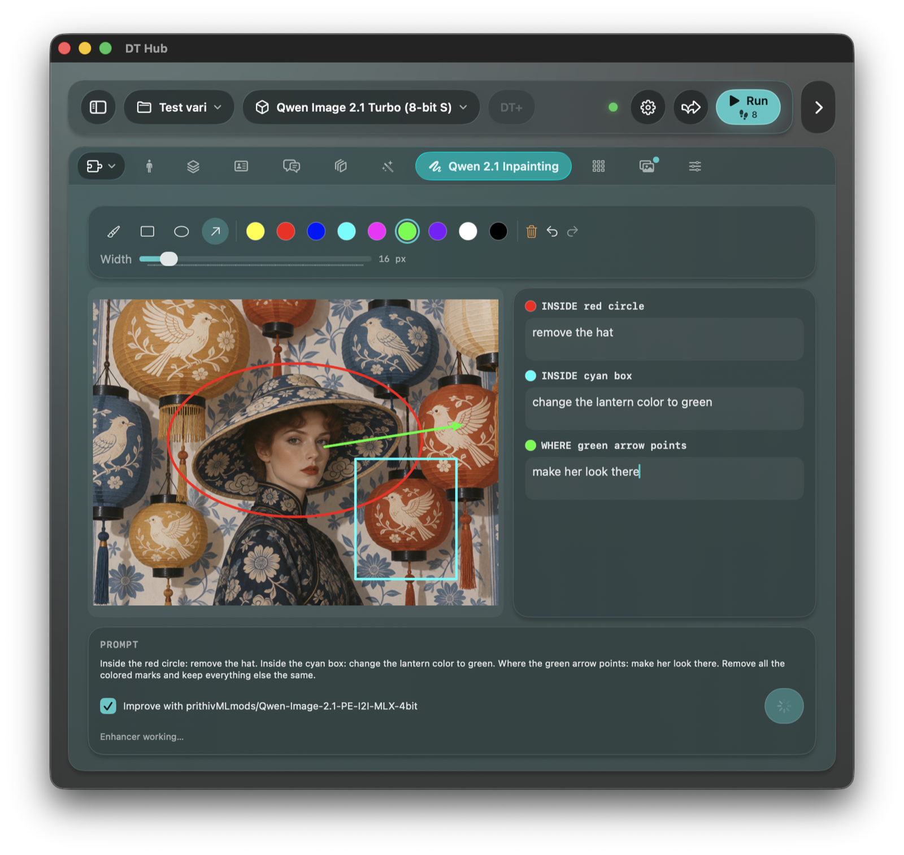

# Qwen 2.1 Inpainting

A plug-in for DT Hub for **Qwen Image 2.1**, inspired by the Sketch node of ComfyUI-Pixaroma (no code of that project is used). **Works with: Qwen Image 2.1 only.**

  
  

You draw **colored marks** on the start image (brush, rectangle, oval, arrow) and, for each pair of **color and tool**, write what to change there. *Send* puts the drawing in the **Brush layer** of the Canvas card in the Control tab and writes the prompt. At RUN the app puts the drawing over the image; Qwen reads the instructions and removes the marks. There is no mask.

## Drawing

- **Tools:** brush, rectangle, oval, arrow; the **width** goes from 4 to 128 px of the start image. **Nine pure colors:** yellow, red, blue, cyan, magenta, green, purple, white, black. Undo, Redo and Clear all (up to 200 marks).
- The start image is the one of the Control tab. When it changes, the marks go (the texts stay).

## Cards and prompt

There is **one card for each pair of color and tool**: two green rectangles are one card, a green rectangle and a green brush stroke are two. The title and the sentence use the plural when there is more than one mark:

| Tool | Card title | Sentence in the prompt |
| --- | --- | --- |
| rectangle | `INSIDE red box(es)` | `Inside the red box(es): <text>` |
| oval | `INSIDE red circle(s)` | `Inside the red circle(s): <text>` |
| brush | `INSIDE red sketch(es)` | `Inside the red sketch(es): <text>` |
| arrow | `WHERE red arrow(s) point(s)` | `Where the red arrow(s) point(s): <text>` |

The sentences, in the order of the cards, are followed by **«Remove all the colored marks and keep everything else the same.»** The text of a card is kept even when its marks are gone. A drawing without any text only sends the drawing and leaves the Prompt field alone.

## Qwen's prompt enhancer

If an LLM is assigned to **Qwen Image 2.1 · I2I** in Settings › LLM (the PE I2I), a box *Improve with …* appears (off by default): the prompt is sent to it together with the start image and the marks, and the rewritten prompt is written into the tab. If it fails, the direct prompt is sent and the status says why. Without it, the sentences go straight into the prompt.

## For AI agents (MCP)

Since **1.3**. With DT Hub's remote control on (Settings › Remote control), the plug-in **on for the job** and Qwen Image 2.1 in the header, an agent sees these tools, named `plugin__qweninpainting__<tool>`. The picture is the app's start image (`set_start_image`), as the Canvas has it when the app sends it framed. A mark's coordinates are **fractions of that picture from 0 to 1, x to the right and y downward, origin at the top left**.

- `get_status` (read): whether there is a start image (and its size), the marks (number, tool, colour, width, points), the cards of text with their counts, the prompt Send would write, Undo and Redo, whether the enhancer is available and on, and what stops Send.
- `add_mark`, `remove_mark`, `clear_marks`, `undo_mark` (edit, «Modify the tab» or more): they draw what the tab draws. `add_mark` takes `tool` (`box`, `circle`, `arrow`, `sketch`), `color` (the nine pure colours), `width` (4–128 px of the start image) and, for a box, an oval or an arrow, `x1, y1, x2, y2` (two opposite corners; the tail and the tip); for a sketch `points` as «x,y x,y …» (2 to 4000 points). The plug-in is strict: a value outside 0–1, a box that is a hair thin, an arrow that is a dot, a width out of range, arguments of another tool, a missing start image or more than 200 marks are refused, and nothing changes. The marks go (the texts stay) a moment after the start image changes (the app frames the new picture first).
- `set_card_text` (edit): what to change for one pair of colour and tool («Inside the red box: …»); kept even when the marks are gone.
- `preview_drawing` (read): the marks over the start image as a picture file in the app's temporary folder, to look at before sending (a client with file access can open it; the app's `get_image` takes only results).
- `send_drawing` (edit): the Send button: the drawing goes to the Canvas's Brush layer and the prompt, written from the texts, replaces the Prompt field. With `enhance: true` (and an I2I enhancer assigned in Settings › LLM) Qwen's enhancer rewrites it first (a few minutes; up to ten, and the app's stop does not reach the model); the answer gives the prompt that went into the field.

**Nothing here generates.** After `send_drawing` the agent uses the app's own `run`, which makes one image through the usual path (the session budget and the user's confirmation threshold apply). The texts come from the project and from the agent's own calls: DT Hub shows them to the agent as data, not instructions.

## State

The marks, the texts, the tool, the color, the width and the box are kept **per project**.

## Requirements

DT Hub 0.1.7 or later (the app has to accept `contribute.paint`), and Qwen Image 2.1 selected.

Build: `Plugins/QwenInpainting/Scripts/build.sh <folder>` → `QwenInpainting.dthubplugin`. Tests: `swift test` in this folder. Design: `docs/superpowers/specs/2026-10-10-plugin-qwen-inpainting-design.md`.
