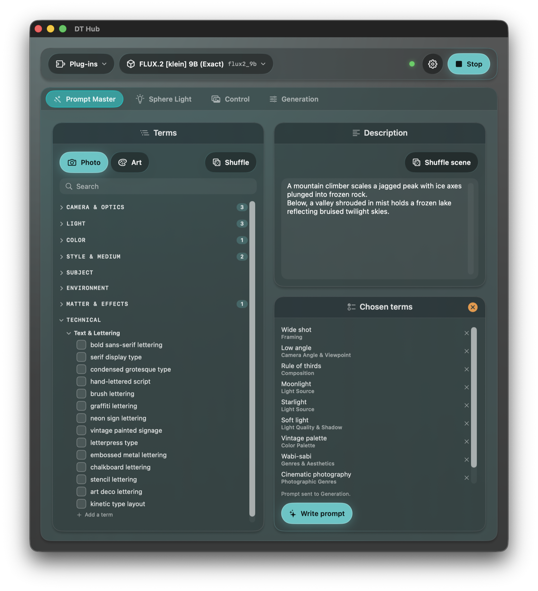
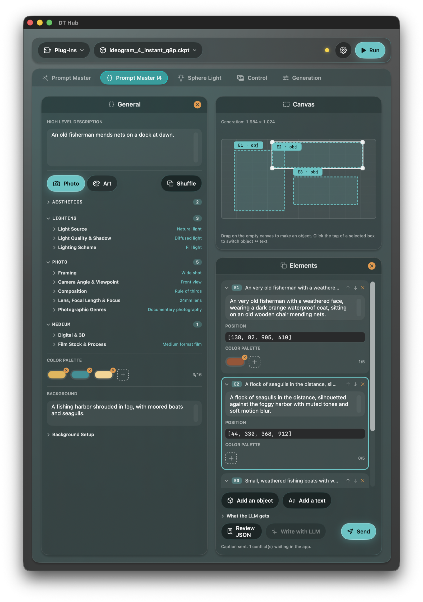
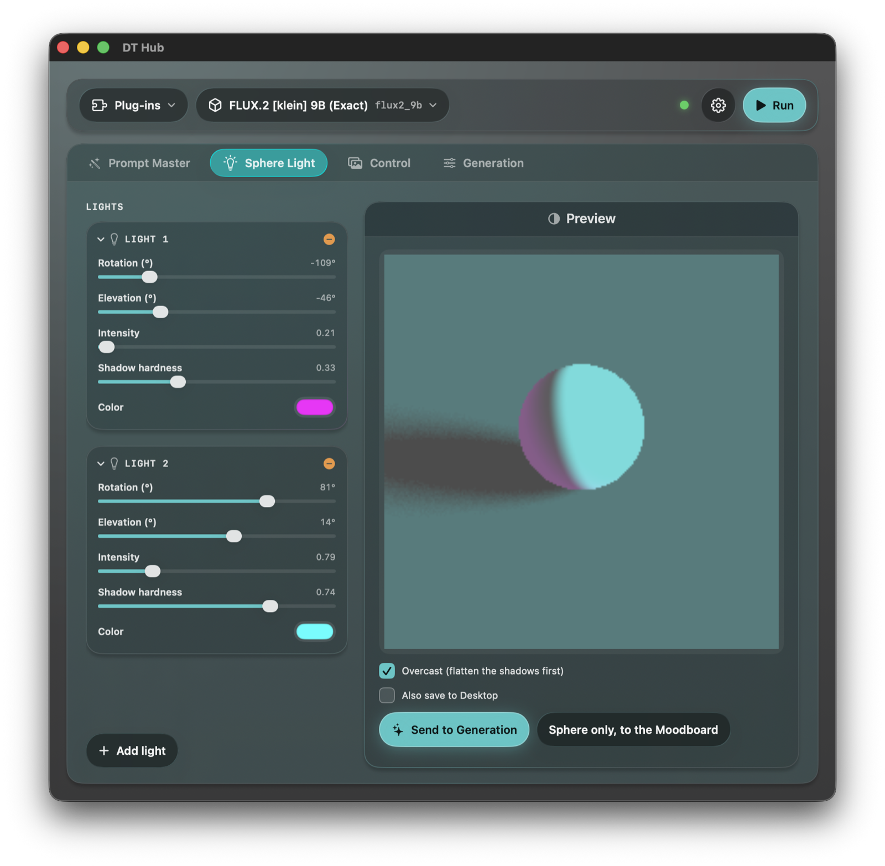

# DT Hub plug-ins

Eleven plug-ins ship in this repository. Each is a Swift package of its own, with its own tests and its own README. Prompt Master, Prompt Master I4, Sphere Light, Batch plus, AI Assistant, Qwen 2.1 Inpainting, Depth & Pose, Tiled Upscale and Flux3 Editing keep their state per project.
A plug-in only works with the model families it was made for (Depth & Pose, with edit and in-context models): on any other model it is **switched off and its tab is hidden**,
so the tab bar only ever shows what can be used with the model you picked.

| Plug-in | Works with | What it does |
| --- | --- | --- |
| **[Prompt Master](PromptMaster/README.md)** | FLUX.1, FLUX.2 (dev, klein 9B, klein 4B), Krea 2, Qwen Image, Qwen Image 2.1, Z Image, Stable Diffusion XL (and Pony / Illustrious), Stable Diffusion 1.5, ERNIE-Image, HiDream-I1, Anima (Cosmos 2.5): **13 families** | A database of 875 curated terms (8 groups, 40 categories: photography, light, colour, style, matter) that you pick with checkboxes, plus a free description in any language. *Write prompt* sends everything to the app's local LLM together with the prompt of the selected model family (DT Hub's own Family prompt: needs DT Hub 0.1.9 or later), and the English prompt that comes back is written into the Generation tab (and into the negative prompt, for families that read one). Includes Shuffle and Shuffle scene. |
| **[Prompt Master I4](PromptMasterI4/README.md)** | **Ideogram 4** only | Composes the fixed-order JSON caption the model was trained on. Pick terms from the database, write the texts, and place objects and lettering on a canvas with their boxes and colours; the JSON is previewed live, and the LLM can write the descriptions for you. |
| **[Sphere Light Reference](SphereLight/README.md)** | The **FLUX.2 [klein]** family (**9B** recommended, better results; 4B works too), with the [Sun Direction LoRA](https://huggingface.co/eric-venti-seeds/Sun-Direction-Lora-Flux2Klein9B) | Place lights on a sphere, render it (CPU ray tracing) and send it to Draw Things so the light, the colours and the sun direction of an image match the sphere. **Multiple and coloured lights are exclusive to this plug-in**: it pushes the LoRA beyond its original limits. |
| **[Character Sheet](CharacterSheet/README.md)** | **Qwen Image 2.1** only | Prepares a character design sheet from one picture: a base sheet (views, poses, silhouettes, expressions, details), a 4×3 expressions sheet or a 5×2 poses sheet. The picture goes to the Moodboard, the canvas is set and the prompt is written, either from a static prompt or by a local vision model (Qwen3-VL, or Qwen's PE I2I prompt enhancer). **Based on [NeuroContent's workflow](https://civitai.com/models/2960750/qwen-image-21-character-design-sheet-maker-workflow?modelVersionId=3377047).** |
| **[Batch plus](BatchPlus/README.md)** | **All families** | Prepares a series of consecutive RUNs and sends it as a pipeline: either numeric parameters that grow by an increment (steps, guidance, shift, CFG-Zero\* initial steps, seed, LoRA weights, varying together) or a bulleted list of prompts, one pass each. |
| **[AI Assistant](AIAssistant/README.md)** | **All families** | Chat with a local LLM about the prompt and the settings; it can describe the start image and the Moodboard pictures. With the `<DO IT>` command it writes the prompt, the parameters, the strength or a pipeline into the Generation tab (you always press Run yourself). Chats are kept per project. Needs DT Hub 0.1.6 or later. |
| **[Qwen 2.1 Inpainting](QwenInpainting/README.md)** | **Qwen Image 2.1** only | Draw boxes, circles, arrows and sketches in nine colours on the start image and write what to change for each colour and tool; it sends the drawing to the Brush layer and writes the prompt, directly or through Qwen's PE I2I. Needs DT Hub 0.1.7 or later. |
| **[LoRA Advisor](LoRAAdvisor/README.md)** | **All families** (DT Hub 0.2.2 or later) | A visual list of your LoRAs with a thumbnail and notes each, filled in from the LoRA's page on Civitai or Hugging Face (found by name, chosen among candidates, or from a link you paste) and summarised by the local LLM; and the LLM's advice on which LoRAs of the current model's family suit a prompt or a request. It uses the network, only when you press its buttons. |
| **[Depth & Pose](DepthPose/README.md)** | **Edit and in-context models** (FLUX.2, Qwen Image 2.1, Qwen Image Edit, FLUX.1 Kontext…) | A depth map ([Depth Anything V2](https://github.com/DepthAnything/Depth-Anything-V2) Base, Core ML) and/or a DWPose-style skeleton (body, face and hands, [DWPose-L](https://github.com/IDEA-Research/DWPose) in Core ML) from one picture, in about a second, sent to the Moodboard as a reference or saved on your Desktop. The two models (about 200 MB, CC BY-NC 4.0, and about 64 MB, Apache-2.0) are downloaded once each, when you press their buttons, from this repository's releases; that is its only use of the network. |
| **[Tiled Upscale](TiledUpscale/README.md)** | **Edit models: FLUX.2 [klein] 9B, Qwen Image 2.1 and its Turbo** | Enlarges a picture 2× or 4× tile by tile: each overlapping tile is regenerated with a preset and a LoRA ([UltraReal v5 Pro](https://civitai.com/models/2462105?modelVersionId=3370879) for FLUX.2 klein 9B, [Qwen Image 2.1 Fix v2.0](https://huggingface.co/e-n-v-y/Qwen-Image-2.1-Fix-v2.0) for Qwen) and put back before the next, with a mask, a fade of the join and a correction of the brightness so the joins do not show. The tile size sets itself (at most three tiles along the short side), the result goes to the Results, and any tile can be picked in the preview and made again from the original, with its own instructions. Additional instructions can be added to the prompt. Sizes are kept in multiples of 64. Needs DT Hub 0.3.6 or later. |
| **[Flux3 Editing](Flux3Editing/README.md)** | **FLUX.3 [klein] 5.6B**; needs DT Hub 0.3.8 or later | Builds the editing prompt of FLUX.3 with reference pictures: draw a box on an object of a Moodboard picture and its pair on the start image, or draw boxes on the start image to add, keep, move or remove something. The start image is shown as the output canvas, placed as in the Control tab; the pairs have their own colours, the LLM can write the texts without touching the placeholders. |

  
  
  

## Install

Every [release](https://github.com/EXistenz-78/dt-hub/releases/latest) carries the ten plug-ins. Download the one you want, unzip it (you get a `.dthubplugin` bundle):

- [Prompt Master](https://github.com/EXistenz-78/dt-hub/releases/latest/download/PromptMaster.dthubplugin.zip)
- [Prompt Master I4](https://github.com/EXistenz-78/dt-hub/releases/latest/download/PromptMasterI4.dthubplugin.zip)
- [Sphere Light Reference](https://github.com/EXistenz-78/dt-hub/releases/latest/download/SphereLight.dthubplugin.zip)
- [Character Sheet](https://github.com/EXistenz-78/dt-hub/releases/latest/download/CharacterSheet.dthubplugin.zip)
- [Batch plus](https://github.com/EXistenz-78/dt-hub/releases/latest/download/BatchPlus.dthubplugin.zip)
- [AI Assistant](https://github.com/EXistenz-78/dt-hub/releases/latest/download/AIAssistant.dthubplugin.zip)
- [Qwen 2.1 Inpainting](https://github.com/EXistenz-78/dt-hub/releases/latest/download/QwenInpainting.dthubplugin.zip)
- [LoRA Advisor](https://github.com/EXistenz-78/dt-hub/releases/latest/download/LoRAAdvisor.dthubplugin.zip)
- [Depth & Pose](https://github.com/EXistenz-78/dt-hub/releases/latest/download/DepthPose.dthubplugin.zip)
- [Tiled Upscale](https://github.com/EXistenz-78/dt-hub/releases/latest/download/TiledUpscale.dthubplugin.zip)

Then, in DT Hub, open **Preferences › Plug-ins**, press **Add…**, pick the `.dthubplugin` bundle and restart the app (turning a
plug-in on or off, or removing it, takes effect at the next launch). Each plug-in then appears as a tab, and can be switched on and off
there or from the plug-in menu in the header.

A plug-in runs code on your Mac with the same permissions as DT Hub: add only plug-ins you trust. The bundles are ad-hoc signed; if
macOS reports one as blocked, clear its quarantine flag with `xattr -dr com.apple.quarantine <the .dthubplugin>` and add it again.

## Build a plug-in bundle yourself

Each plug-in has a `Scripts/build.sh` that makes the bundle. For example, for Prompt Master I4:

    Plugins/PromptMasterI4/Scripts/build.sh "$TMPDIR/pm-i4"

The bundle is `$TMPDIR/pm-i4/PromptMasterI4.dthubplugin`: add it from Preferences as above. As an alternative to the Add… button, put it
into `~/Library/Application Support/DT Hub/Plug-ins/` with the bundle identifier as its name, replacing any older version (remove it first:
`cp -R` onto an existing folder would copy *inside* it), and restart DT Hub:

    D="$HOME/Library/Application Support/DT Hub/Plug-ins/com.exiztenz.dthub.promptmasteri4.dthubplugin"
    rm -rf "$D" && cp -R "$TMPDIR/pm-i4/PromptMasterI4.dthubplugin" "$D"

Run a plug-in's tests from its folder: `cd Plugins/PromptMasterI4 && swift test`.

## Writing your own

See [`../PluginKit/README.md`](../PluginKit/README.md): the contract between the app and a plug-in, the messages (`context`, `contribute`,
`llm`, `presets`…), a sample plug-in and the design system.
