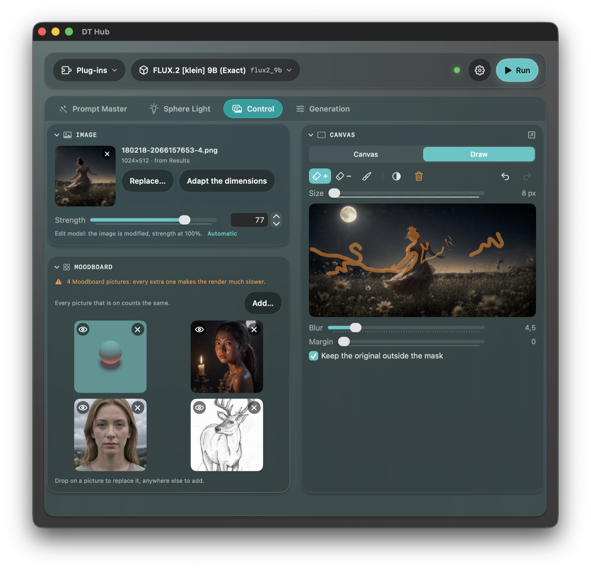
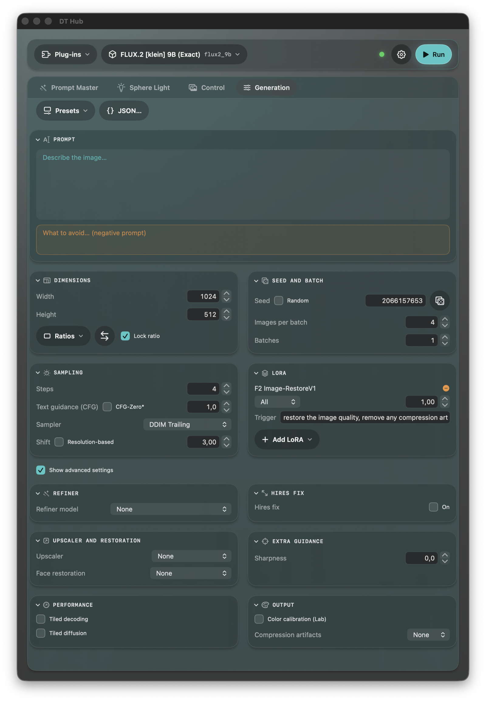
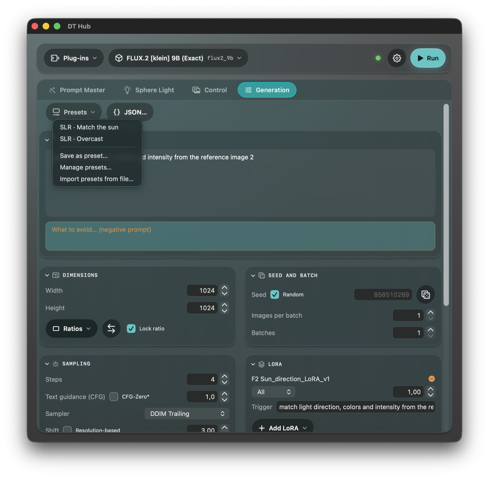
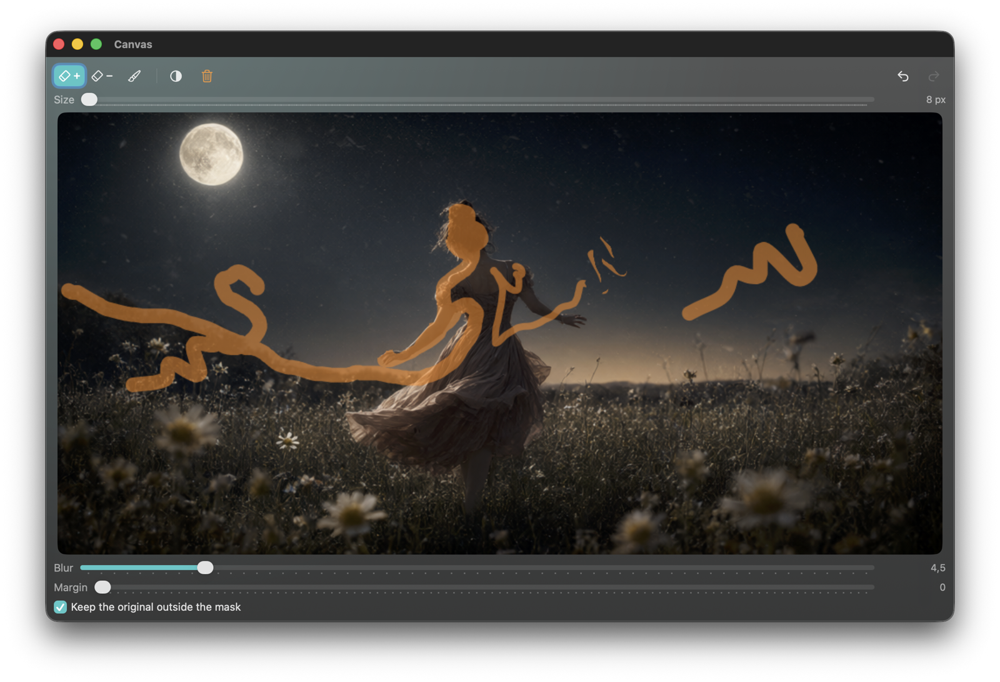
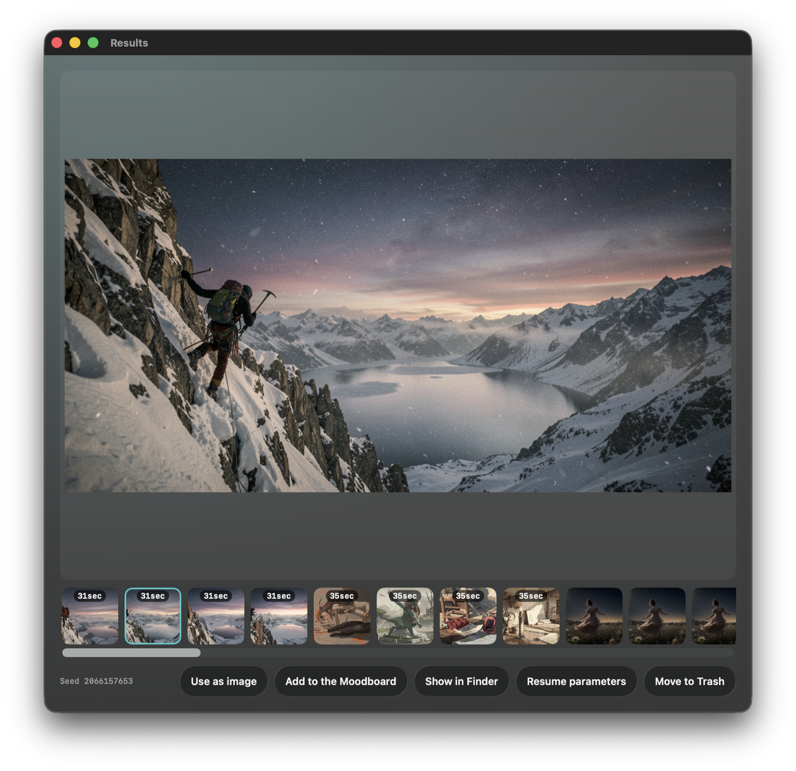
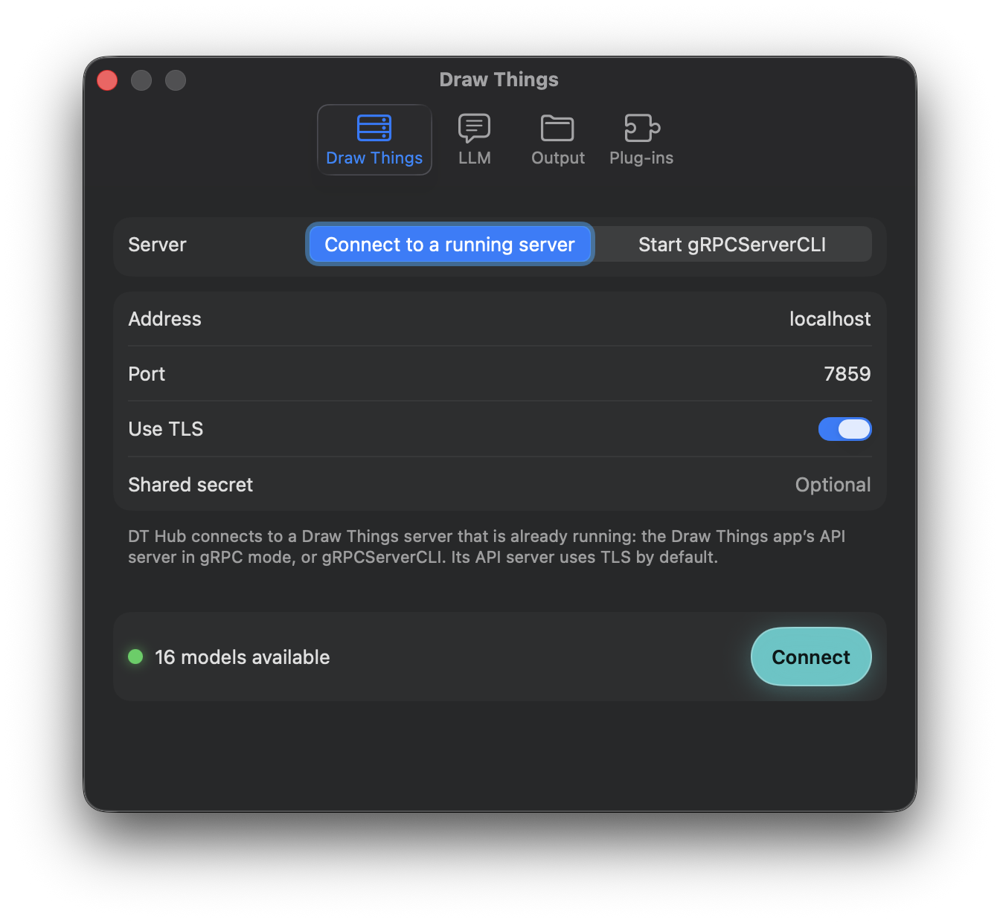
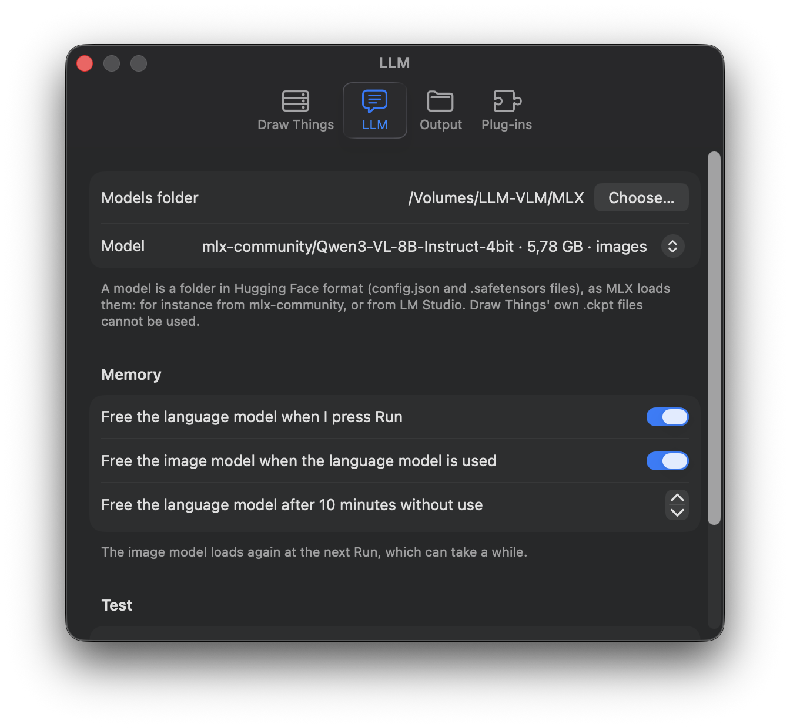
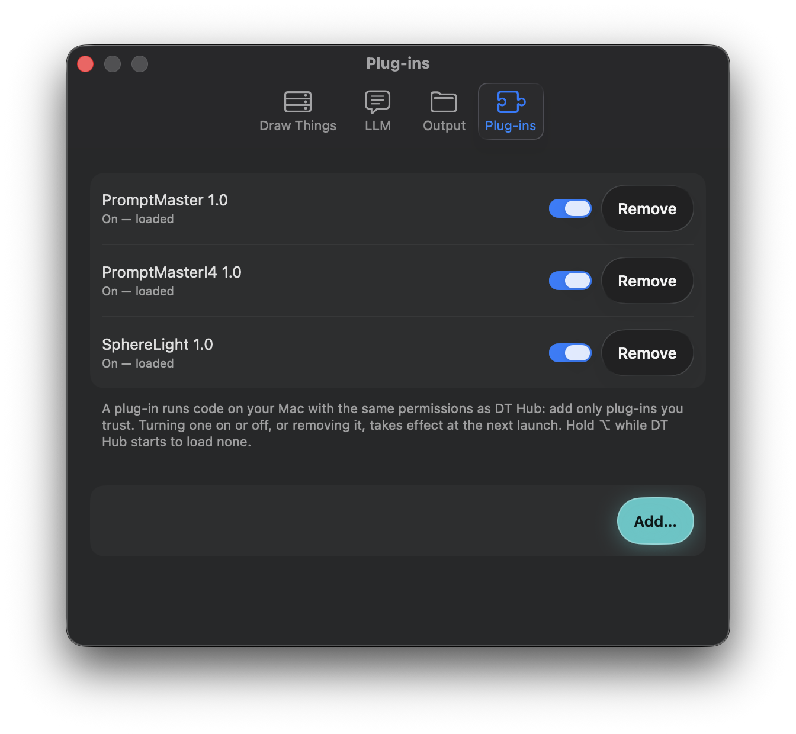

# DT Hub

A native macOS companion for [Draw Things](https://drawthings.ai/): a dedicated workspace for **preparing and launching image generations**. DT Hub connects to the Draw Things gRPC server, which does all the rendering, and adds what sits around it: inputs you can always see, a canvas you can draw on from an iPad, a local LLM that writes and improves prompts, and plug-ins that each bring their own tab.

This is an independent community project, not affiliated with or endorsed by Draw Things Technologies. It started as a personal tool and is published as open source under the GPL-3.0.



## What DT Hub adds

- **Canvas on your iPad.** The Canvas card opens in a window of its own that shows nothing but the drawing, as large as the window allows. Move it to an iPad connected with **Sidecar** and paint the inpainting mask, or draw in colour onto the image, with an **Apple Pencil** or your fingers. Undo and redo keep working in the window.
- **Image and Moodboard always in sight.** The Control tab shows the start image, the Moodboard and the Canvas side by side, never behind a menu: every Moodboard picture can be switched on or off with its eye, and you drag pictures in from the Results strip, the Finder or the clipboard.
- **A lock on the canvas proportions.** Width and height follow the ratio you choose: *Lock ratio* keeps it while you type or step either value, and the Ratios menu and the swap button change it in one click.
- **Everything you made, at hand.** The Results window keeps the images of the session (and brings back the last ones after a restart); each thumbnail shows **how many seconds it took**, can be dragged anywhere, and offers *Use as image*, *Add to Moodboard*, *Show in Finder*, *Resume parameters* and *Trash*. Every PNG is saved with its prompt, its whole configuration and the time it took inside the file, in the same layout as Draw Things' own images, so tools made for those read DT Hub's too.
- **Result details.** A collapsible sidebar in the Results window shows the prompt, settings, LoRAs and timing saved in the selected image; the text can be selected and copied.
- **Incremental mode.** A switch in the header makes each result the start image of the next RUN.
- **Projects.** Each project is a subfolder of the output folder with its own start image, mask, Moodboard, results strip and plug-in state; reopening one restores the prompt and settings of its last image. Switch from the **Project** menu in the header.
- **Your own LoRA trigger words and weights.** *Manage LoRAs…* (LoRA card) lists the LoRAs of the server by model family, compactly: change a trigger word or the default weight (−4 to 4) of any of them. The server's trigger words are inherited and only your changes are kept, in a file of DT Hub's own: Draw Things' files are never touched.
- **Presets and preset pipelines.** Save a configuration as a preset and chain several presets into one Run. Recommended settings per model family are suggested for you.
- **A queue of generations.** The **Queue** sidebar (the button in the header opens and closes it) lines up generations to run one after the other: **+** saves the Generation tab, the pipeline on RUN and everything in Control (images included) as an entry, **Start** restores each entry and presses RUN, and an entry gets a green check when it finishes or an orange ✕ when it fails, after which the queue goes on. Stop ends the run and the queue. The queue is kept per project, on disk. Pipelines a plug-in guides (Tiled Upscale, the seam correction of Panorama 360) can be queued too.
- **A local LLM (MLX)** that runs inside the app and can see images, with controls to free memory so the image model and the LLM can share a Mac. Nothing is downloaded unless you ask for it.
- **Prompt tools.** *Enhance Prompt* rewrites your prompt for the selected model's family (and sees the start image and the Moodboard pictures, so "image 1", "image 2"… keep their meaning) and *Generate Prompt* writes one from the start image, both with the local language model.
- **Plug-ins**, each with its own tab and active only on the model families it was made for: Prompt Master, Prompt Master I4 (Ideogram 4), Prompt Master F3 (the structured prompt of FLUX.3, with boxes), Flux3 Editing (FLUX.3 editing with reference pictures and boxes), Prompt Master MOSS (the JSON layout prompt of MOSS Image: a summary and boxes in pixels from the centre), Sphere Light Reference, Character Sheet (Qwen Image 2.1), Batch plus (a series of RUNs with growing parameters, or one per prompt; all families), AI Assistant (chat with a local LLM that can write the prompt and the settings on command), Qwen 2.1 Inpainting (colored marks and instructions on the start image, for Qwen Image 2.1) LoRA Advisor (a visual list of your LoRAs with thumbnails and notes, and the LLM's advice on which to use; all families), Depth & Pose (a depth map and a DWPose-style skeleton with face and hands from one picture, sent to the Moodboard; edit and in-context models) Tiled Upscale (a 2× or 4× enlargement tile by tile with FLUX.2 klein 9B, FLUX.3 klein or Qwen Image 2.1, with joins that do not show; the result goes to the Results) and Panorama 360 (360° panoramas: pictures placed on the unrolled sphere become the start image for nomadoor's *360 ERP outpaint* [LoRA](https://huggingface.co/nomadoor/flux-2-klein-9B-360-erp-outpaint-lora) of FLUX.2 klein; inspired by the [ComfyUI-Panorama-Stickers](https://github.com/nomadoor/ComfyUI-Panorama-Stickers) custom nodes) and Pano 360 F3 (360° panoramas with FLUX.3 [klein] 5.6B and denrakeiw's *360* and *Seamfix* LoRAs: the reference pictures go in the Moodboard, with no start image, and the panorama pass and the seam-fixing pass run as one guided pipeline). See [`Plugins/`](Plugins/README.md).
- **Keyboard.** ⌘↩ Run, ⌘. Stop, ⌘R Results, ⌃Page Up / ⌃Page Down to step through the tabs.
- **Managed server.** DT Hub can start Draw Things' `gRPCServerCLI` by itself, or connect to the server of the Draw Things app.
- **DT+ (Draw Things+ cloud).** When DT Hub is connected to the Draw Things app with Bridge Mode on, the **DT+** switch next to the model menu lists the models the cloud can run (asked to Draw Things' cloud server, no account involved) and adds the cloud's LoRAs to yours, always for the current model. Account and subscription stay in the Draw Things app.
- **CU meter.** With DT+ on, a meter next to the switch shows the compute units (CU) the next RUN needs against the DT+ limit per RUN (40 000 CU, or the policy Draw Things announces), green, amber and red, with the boosts a RUN above the limit needs. For a pipeline it shows the heaviest pass. It estimates with Draw Things' own calculation (ported from its open source code) for the image families (FLUX, Qwen, Z Image, SD 1.5, SDXL, Cosmos and more) and, with the same formula, for the video models MiniMax H3 and LTX-2.3 (not yet verified against the Draw Things bar); other video families and a few old families show a dash. It only advises: the cloud decides.
- **A model picker for DT+.** The cloud has hundreds of models, so with DT+ on the model button opens a panel with a search field and the models grouped as Draw Things groups them: **Official**, **Community** and **Uncurated**, and inside each by family; every group opens and closes (only Official is open at first). It lists the Official models too, downloaded or not, and hides the models of your server that Draw Things does not list. With DT+ off the menu is the one of the models installed on your server.
- **New models without waiting for an update.** When it connects, DT Hub downloads the lists of official models and of their recommended settings that Draw Things publishes (`models.drawthings.ai`, the same lists the Draw Things app reads) and keeps a copy, so a model released after this version of DT Hub is recognised, with its own steps, guidance, sampler and shift, as soon as its file is in your models folder. Offline, the saved copy is used. Nothing of yours is sent.

## A look around

**Generation.** The prompt (with the negative prompt, shown only for the families that use it) and collapsible cards for dimensions, sampling, seed and batch, LoRAs and an advanced section. Every value can be typed or stepped, the open or closed state of each card is remembered, and a JSON editor shows and edits the whole configuration.

<p align="center"></p>

**Presets.** Save a configuration as a preset, import and manage them, and let a plug-in register its own: Sphere Light's two presets, for example, are chained into one Run. You can also build your own pipelines: **Create Pipeline…** in the Preset menu lines up your presets in the order you tick them; each pass can use its preset's model, scale the size of the previous pass and have its own strength, and the result of a pass can be the start image of the next.

<p align="center"></p>

**Canvas window.** Only the drawing, for the Pencil.



**Results.** Live preview while generating, then the image; the strip shows the seconds each picture took.



**Preferences.** The Draw Things server, the local LLM and its memory behaviour, the output folder and the plug-ins.

<p>
  
  
  
</p>

## Requirements

- macOS 26 and an Apple Silicon Mac.
- A Draw Things gRPC server: the Draw Things app with its API server enabled, or the `gRPCServerCLI` binary, which DT Hub can start itself.
- To build: Xcode 27.

## Install

1. Download **`DT-Hub-0.7.1-macOS-arm64.zip`** from the [latest release](https://github.com/EXistenz-78/dt-hub/releases/latest).
2. Unzip it and drag **DT Hub.app** into `/Applications`.
3. Read **First launch** below before you open it.
4. Optional: add the plug-ins (they are in the same release, see [`Plugins/`](Plugins/README.md#install)).

You also need a Draw Things gRPC server (see Requirements).

## First launch (important)

The app is signed with an Apple Development certificate but it is **not notarized**, so macOS Gatekeeper refuses to open it the first time. This is expected, not a broken download.

When you see *"Apple could not verify 'DT Hub' is free of malware"*:

1. Open **System Settings › Privacy & Security**.
2. Scroll down: there is a line saying **"DT Hub" was blocked**.
3. Click **Open Anyway** and confirm in the dialog that appears.

You only need to do this once per download. If you would rather not trust a binary, build it yourself from source (below).

## Updating the server (`gRPCServerCLI`)

When DT Hub starts the server for you, it runs the `gRPCServerCLI` binary you chose in **Preferences › Draw Things**; the same pane shows which release it is and tells you when a newer one exists. DT Hub does not update it by itself:

1. Download `gRPCServerCLI-macOS` from the [Draw Things releases](https://github.com/drawthingsai/draw-things-community/releases) and put it in place of the old one (same folder, same name, so the path in Preferences stays valid).
2. A file downloaded with a browser is not executable and is marked as quarantined by macOS, so the server will not start. In Terminal, with the path of your file:

```bash
chmod +x "/path/to/gRPCServerCLI-macOS"
```

```bash
xattr -d com.apple.quarantine "/path/to/gRPCServerCLI-macOS"
```

3. Start the server again from DT Hub (Connect, or restart the app).

The second command tells macOS to skip its check on a downloaded program: run it only on a file you downloaded yourself from the official releases page.

## Build from source

1. Install the Metal Toolchain once (MLX's shaders need it):

        xcodebuild -downloadComponent MetalToolchain

2. Open `DTHub.xcodeproj` in Xcode and run the **DTHub** scheme, or from a terminal:

        xcodebuild -project DTHub.xcodeproj -scheme DTHub -destination 'platform=macOS' build

3. The logic lives in Swift packages: run its tests from `Packages/`:

        cd Packages && swift test

   Each plug-in is a package of its own, with its own tests (`cd Plugins/PromptMasterI4 && swift test`).

## The local LLM

DT Hub looks for MLX models (Hugging Face format: a folder with `config.json` and `.safetensors` files) in the folder you choose in **Preferences › LLM**. The recommended model is `mlx-community/Qwen3-VL-8B-Instruct-4bit` (about 5.8 GB, Apache-2.0); the Preferences can download it, but only when you ask and after a dialog that names the repository, the size and the destination. The same pane has a test question, with or without an image.

Each installed LLM can be assigned to a model family and a use (enhance, generate, both, plug-ins only); a dedicated LLM's own `system_prompt.txt` is used when present. With a single LLM installed nothing needs to be set up.

### Recommended LLMs

These are the models the author uses, with the setting of **Family** and **Use** that goes with each in **Preferences › LLM**. Put each one in its own folder inside the models folder (a folder per model; one level of folders, such as `mlx-community/` or `prithivMLmods/`, is fine). All of them are MLX conversions that read pictures.

| Model | Size | Family | Use | What for |
| --- | --- | --- | --- | --- |
| [mlx-community/Qwen3-VL-8B-Instruct-4bit](https://huggingface.co/mlx-community/Qwen3-VL-8B-Instruct-4bit) (Apache-2.0) | about 5.8 GB | **All others** | **Both** | The general LLM: Enhance Prompt, Generate Prompt, the plug-ins and the chat, for every family that has no LLM of its own. It is also the one *Download the recommended model* fetches. |
| [mlx-community/flux-3-image-klein-pup-8bit](https://huggingface.co/mlx-community/flux-3-image-klein-pup-8bit) (Apache-2.0; also a [4-bit copy](https://huggingface.co/mlx-community/flux-3-image-klein-pup-4bit), about 6 GB) | about 10 GB | **FLUX.3 [klein]** | **Both** | BFL's own prompt upsampler [black-forest-labs/flux-3-image-klein-pup](https://huggingface.co/black-forest-labs/flux-3-image-klein-pup), dedicated to FLUX.3 [klein]. It is used by Enhance Prompt, Generate Prompt, Prompt Master F3 and Flux3 Editing with its official prompts: see below. |
| [prithivMLmods/Qwen-Image-2.1-PE-I2I-MLX](https://huggingface.co/prithivMLmods/Qwen-Image-2.1-PE-I2I-MLX) (Qwen research licence; download the contents of its `4bit` folder) | about 6 GB | **Qwen Image 2.1** | **I2I (images in Control)** | The prompt rewriter of Qwen Image 2.1 for editing: it reads the pictures of the Control tab and the instruction. |
| [prithivMLmods/Qwen-Image-2.1-PE-T2I-MLX](https://huggingface.co/prithivMLmods/Qwen-Image-2.1-PE-T2I-MLX) (Qwen research licence; the `4bit` folder as well) | about 6 GB | **Qwen Image 2.1** | **T2I (empty Control)** | The same rewriter for text-to-image: it turns a short request into a detailed prompt. |

With this setup a FLUX.3 [klein] prompt goes to the prompt upsampler, a Qwen Image 2.1 prompt goes to the I2I or the T2I rewriter depending on whether the Control tab has pictures, and every other family goes to Qwen3-VL. An LLM on **All others** serves every family without an LLM of its own; **Plug-ins only** keeps a model away from the prompt buttons. The sizes are those of the files on Hugging Face.

### The FLUX.3 prompt upsampler (PUP)

If the LLM assigned to a family is Black Forest Labs' own prompt upsampler (`black-forest-labs/flux-3-image-klein-pup`, or a converted copy such as `mlx-community/flux-3-image-klein-pup-8bit`: the folder has a `system_prompts.json`), DT Hub uses the model's **official prompts** instead of the family prompts above:

- *Enhance Prompt* uses `t2i` when the Control tab has no pictures, and `i2i` when it has: the start image and the Moodboard pictures that are on go to the model, in that order. A prompt that ends with a table of boxes (as Prompt Master F3 and Flux3 Editing write it) goes through `t2i_bbox` / `i2i_bbox`, and your boxes and ids are put back into the answer.
- *Generate Prompt* always uses `i2i`, with the start image. **Whatever is in the prompt field goes along as the request**, so a prompt left over from another image will mix with what the model sees: clear the field first for a pure description of the picture (an empty field asks the model to describe the image as a detailed prompt).
- The model decodes as BFL does (greedy, top-p 0.95, top-k 20), no thinking.

Prompt Master F3 and Flux3 Editing do the same with their own prompts (`t2i_bbox` and `i2i_bbox`). Without the PUP everything works as before. A converted PUP whose `preprocessor_config.json` lacks `processor_class` is fixed by DT Hub when it loads the model.

### The prompts that guide the LLM

What *Enhance Prompt* and *Generate Prompt* tell the LLM is not hidden in the code: it is a set of Markdown files in `~/Library/Application Support/DT Hub/Data/DTHub/`, written by the app at launch and read at every request.

- `rules/` — the rules of the task (`enhance.md`, `describe.md`).
- `family/` — the instructions of each model family (one file per family, named with the id of the family), including the rule for the answer (plain prose, or JSON with a negative prompt) and the length. **These are the app's own files: changing them is not recommended** (a newer version of the app rewrites them, keeping the old one as `.md.bak`).
- `custom/` — **yours**. `enhance.md` and `describe.md` add instructions for a task; `family-<id>.md` adds them for one family. They go last and win if they disagree with the app's. A file may start with a header `---` / `mode: replace` / `---` to replace the app's text instead of adding to it. `custom/families.txt` lists the names and ids of the families.

An LLM that comes with a system prompt of its own (Qwen's prompt enhancers) receives only your `enhance.md` / `describe.md`, added after its own text; being trained for one job, such a model may ignore instructions that go against it (for example to write in another language).

**Preferences › LLM › Prompts** opens the folder, shows which families have a file of their own and the final text the LLM receives.

## Plug-ins

A plug-in is a bundle (`.dthubplugin`) with a dynamic library, loaded into the app and shown as a tab. You add one in **Preferences › Plug-ins**. A plug-in only works with the model families it was made for: on any other family it is switched off and its tab is hidden. Plug-ins work on your Mac; the two exceptions are LoRA Advisor, which contacts Civitai and Hugging Face when you press its buttons to find or import a LoRA's page, and Depth & Pose, which downloads its two models from GitHub once each, when you press their buttons (each says what it sends in its README). The plug-ins in this repository, which families each one works with, and how to build and install them are described in [`Plugins/README.md`](Plugins/README.md). To write your own, start from [`PluginKit/README.md`](PluginKit/README.md): the app and a plug-in talk only through Objective-C selectors and JSON messages, and the kit includes the design system so a plug-in tab looks like the rest of the app.

## Languages

The interface of the app and of the plug-ins is available in **English and Italian** and follows the language of macOS. The design documents in [`docs/superpowers/`](docs/superpowers/) (specs and plans) are written in Italian.

## Repository layout

| Folder | What is in it |
| --- | --- |
| `App/` | The app: connection, controls, generation, main window, plug-in host, preferences, results. |
| `Packages/` | The logic (`HubCore`, `HubKit`, `DTBridge`, `LLMBridge`, `PluginHost`) and its tests. |
| `PluginKit/` | The kit and the design system a plug-in is written with; contract 1 of the plug-ins. |
| `Plugins/` | Prompt Master, Prompt Master I4, Sphere Light Reference, Character Sheet, Batch plus, AI Assistant, Qwen 2.1 Inpainting, LoRA Advisor, Depth & Pose, Tiled Upscale, Panorama 360 and Pano 360 F3 (among others). |
| `docs/superpowers/` | Specs and plans (in Italian). |

## Status

> **Video (in development).** Support for video models (MiniMax H3, LTX-2.3) is still under development: some functions may not work as expected.

An early version (0.7.1), used daily by its author. Feedback, bug reports and ideas are welcome: open an [Issue](../../issues).

## License

[GPL-3.0](LICENSE).

The compute-unit calculation of the CU meter is ported from [draw-things-community](https://github.com/drawthingsai/draw-things-community) (GPL-3.0), by Draw Things Technologies.
